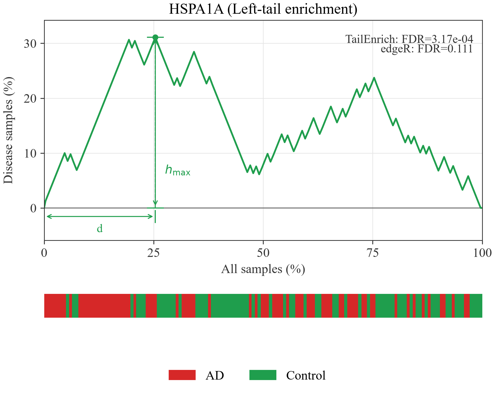
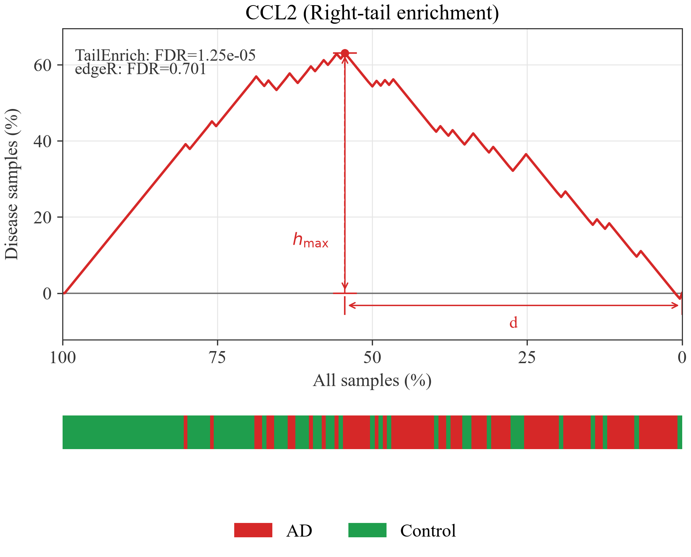

# TailEnrich

TailEnrich detects whether a subset of disease samples is enriched at the lower or upper tail of a gene's expression distribution. For each gene, it ranks disease and control samples by expression level and evaluates disease-sample enrichment at the low- or high-expression end of the ranking.

## 1. Installation

Clone the repository in the RStudio Terminal, then set the cloned folder as the R working directory.

```bash
git clone https://github.com/Sanke926/Tailenrich.git
cd Tailenrich
```

TailEnrich uses R base packages and the bundled `parallel` package; no additional packages are required. The example was run with R 4.5.2.

## 2. TailEnrich Input

TailEnrich requires an expression matrix and a corresponding sample group file. The expression matrix is a CSV file with a header: the first column contains unique gene IDs, and the remaining columns contain sample expression values, with unique sample IDs as column names. Expression values must be finite and nonnegative.

The sample group file is a TSV file with a header and two required columns: `sampleID` and `group`. Each sample must have one row, where `1` represents disease samples and `-1` represents control samples. Sample IDs must match the expression matrix column names, and both groups must be present.

## 3. Example Usage

### 3.1 Example Input Data

The example uses Mayo temporal cortex (TCX) data with 80 Alzheimer's disease (AD) samples, 69 control samples, and 14,412 genes. Isoform TPM values were summed for each gene to obtain gene expression, and covariate effects were then removed using linear regression. The input files are located under `sample_input/Mayo_TCX/`.

| File | Content |
| --- | --- |
| `gene_TPM_covAdjusted.csv` | First column: gene ID; remaining columns: covariate-adjusted gene TPM values |
| `used_samples_group.tsv` | First column: sample ID (`sampleID`); second column: group (`group`), where `1` represents disease samples and `-1` represents control samples |

### 3.2 Running TailEnrich

In RStudio, set the repository root as the working directory, then read the input files and run TailEnrich:

```r
source("src/TailEnrich.R")
input_dir <- "sample_input/Mayo_TCX"
expression_matrix <- as.matrix(read.csv(file.path(input_dir, "gene_TPM_covAdjusted.csv"),
                                       row.names = 1, check.names = FALSE))
groups <- read.delim(file.path(input_dir, "used_samples_group.tsv"))
sample_groups <- groups$group[match(colnames(expression_matrix), groups$sampleID)]

tailenrich_output <- TailEnrich(expression_matrix, sample_groups, seed = 1)
```

See [Function Arguments](docs/api.md) for optional settings such as `n_permutations`, `n_cores`, `fdr_cutoff`, and `log2fc_cutoff`.

### 3.3 Results Interpretation

#### Returned Object and Output Files

`tailenrich_output` contains one row per gene with the seven columns listed below. By default, genes are considered significant when both `fdr < 0.05` and `abs(log2fc) >= log2(1.5)` are satisfied. These thresholds can be customized through `fdr_cutoff` and `log2fc_cutoff` when calling `TailEnrich()`.

| Column | Interpretation |
| --- | --- |
| `gene_id` | Gene ID |
| `direction` | Enrichment direction: `left` or `right` |
| `enrichment_score` | PE score for the selected enrichment direction |
| `log2fc` | Tail-specific log2 fold change |
| `p_value` | Pooled permutation p value |
| `fdr` | adjusted p value |
| `is_significant` | Whether both FDR and absolute log2FC cutoffs are met |

#### Examples of Left- and Right-Tail Enrichment

The following genes illustrate left- and right-tail enrichment. After analyzing the same dataset with edgeR (v4.0.16) as the comparison method, we selected genes identified as significant by TailEnrich but not by edgeR (FDR >= 0.05) as examples.



HSPA1A shows left-tail enrichment (FDR = 3.17e-4; log2FC = -1.430), with disease samples accumulating toward the low-expression end. Here, `h_max` marks the maximum percentage of enriched disease samples, and `d` marks the distance from the low-expression tail to that peak. Red and green strips indicate disease and control samples, respectively. 



CCL2 shows right-tail enrichment (FDR = 1.25e-5; log2FC = 1.495), with disease samples accumulating toward the high-expression end. Here, `h_max` marks the maximum percentage of enriched disease samples, and `d` marks the distance from the high-expression tail on the right to that peak. Red and green strips indicate disease and control samples, respectively.

## 4. Contact

- Yu-He Liu: [244712162@csu.edu.cn](mailto:244712162@csu.edu.cn)
- Hong-Dong Li: [hongdong@csu.edu.cn](mailto:hongdong@csu.edu.cn)
